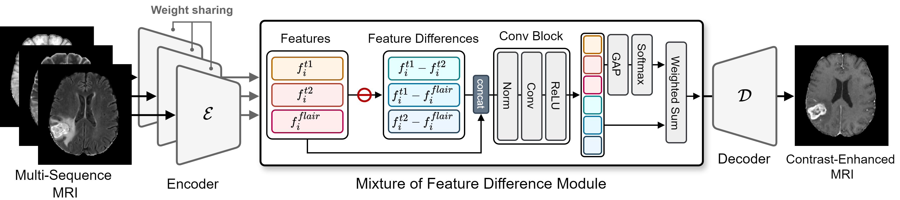

# Paper

Mixture of Multi-Sequence Feature Difference for Contrast-Enhanced MRI Synthesis

[Jonghun Kim],  [Hyunjin Park]

 []() [](https://arxiv.org/abs/2610.21703)<br>


# Overview

This repository contains the code for Mixture of Multi-Sequence Feature Difference for Contrast-Enhanced MRI Synthesis




# Usage

For training, follow the commands below 

```shell
python main.py -b configs/brain.yaml -t True --gpus 0,
```


For sampling, follow the commands below 

```shell
python sampling.py -b configs/brain.yaml -t True --gpus 0,
```


# Citation

```tex
@misc{kim2026mixture,
      title={Mixture of Multi-Sequence Feature Difference for Contrast-Enhanced MRI Synthesis}, 
      author={Jonghun Kim and Junmo Kwon and Hyunjin Park},
      year={2026},
      eprint={2610.21703},
      archivePrefix={arXiv},
      primaryClass={cs.CV},
      url={https://arxiv.org/abs/2610.21703}, 
}
```

